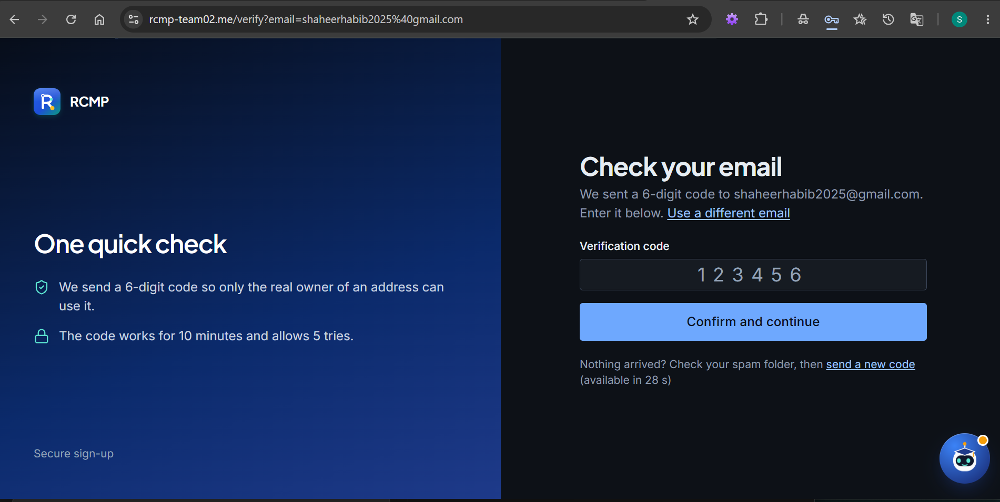
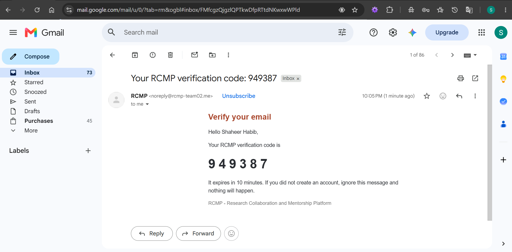
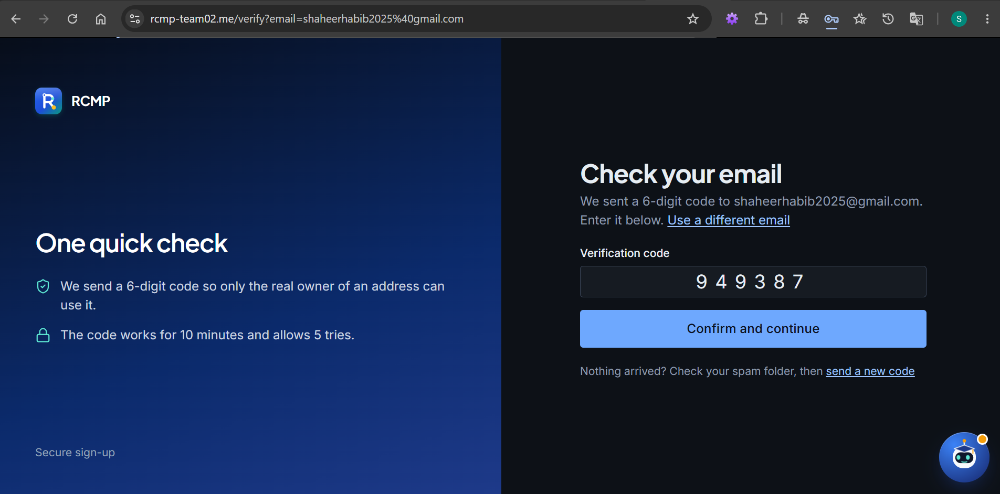
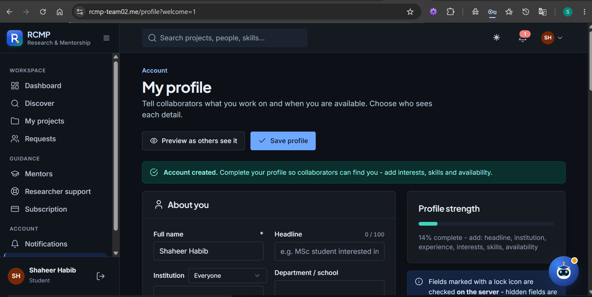
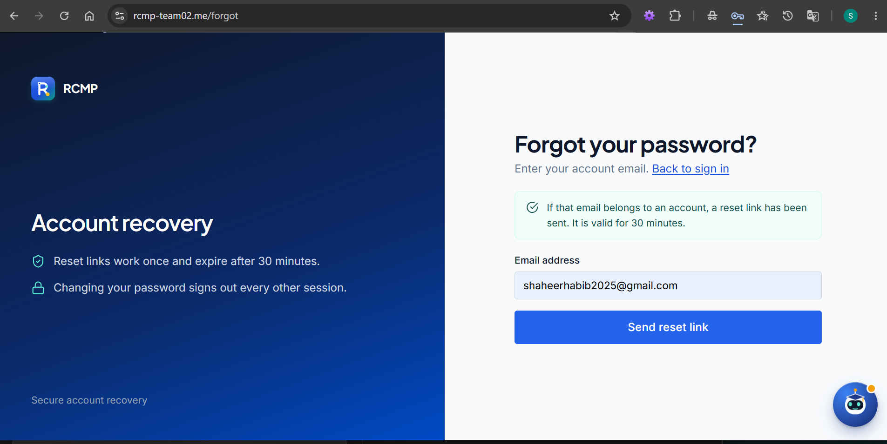
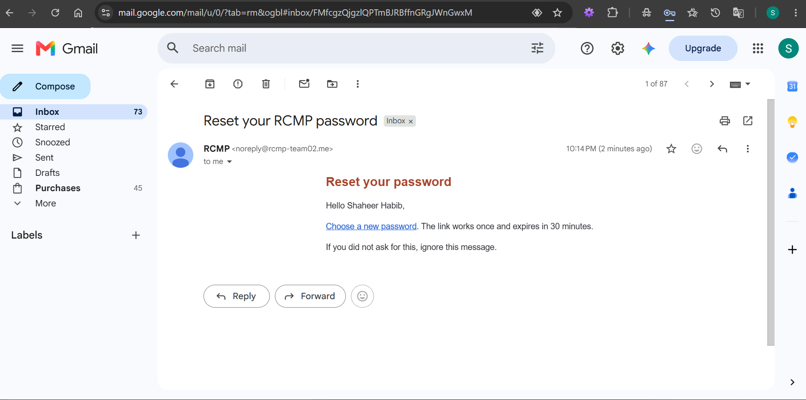
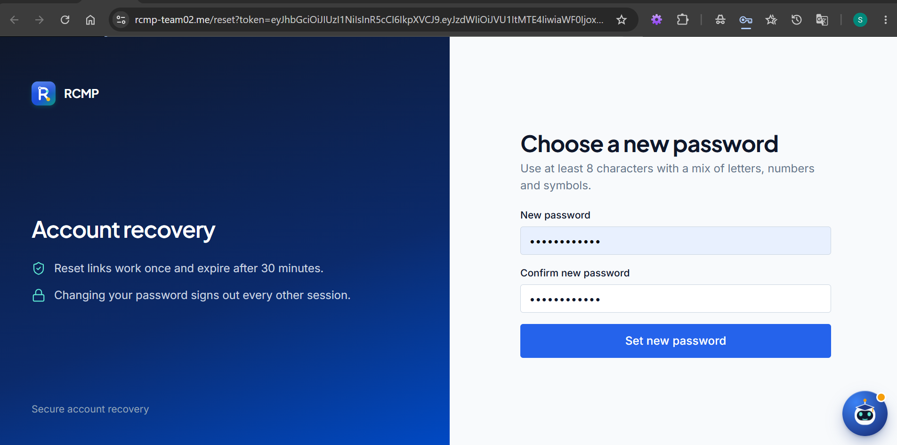
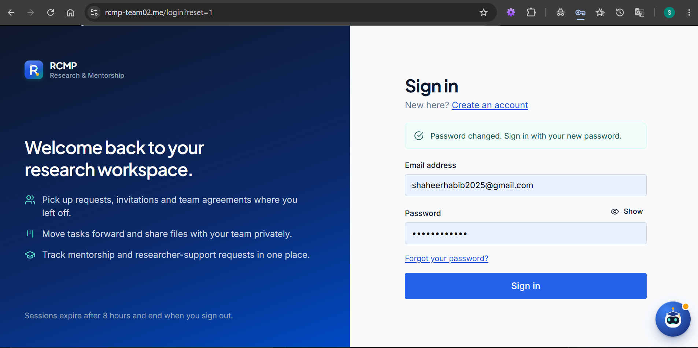
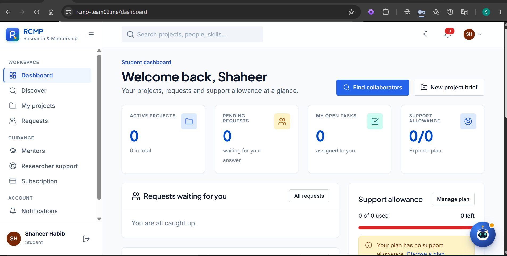

# Real e-mail test (live site, 16 November 2026)

Manual check of the sign-up PIN and password-reset e-mails on the live site https://rcmp-team02.me. The site runs on Render and sends mail through Brevo from `noreply@rcmp-team02.me`. The domain `rcmp-team02.me` is authenticated in Brevo with a Brevo code, two DKIM records and a DMARC record. The Brevo API key is restricted: only Transactional email is set to All.

This is a manual check with screenshots, not an automated test. The automated tests (TC-VF-01 to 12, TC-E2E-19) still use a mocked sender.

| Step | Screenshot | What it shows |
|------|------------|---------------|
| 1 |  `01-sign-up.png` | The verify page after sign-up: a 6-digit code was sent to the address |
| 2 |  `02-code-at-e-mail.png` | The PIN e-mail in Gmail, from RCMP <noreply@rcmp-team02.me>, valid for 10 minutes |
| 3 |  `03-enter-code.png` | The code typed into the verify page |
| 4 |  `04-land-to-profile-page.png` | Account created, the new member lands on the profile page |
| 5 |  `05-forget-password.png` | Forgot password: reset link sent message |
| 6 |  `06-link-on-e-mail.png` | The reset e-mail in Gmail, single-use link valid for 30 minutes |
| 7 |  `07-add-new-password.png` | The page that opens from the link: choose a new password |
| 8 |  `08-password-successfully-changed.png` | Sign-in page: password changed, sign in with the new password |
| 9 |  `09-land-to-dashboard.png` | Signed in with the new password: student dashboard |

Not shown: delivery to other mail providers, spam-folder placement over time, and bounce handling.
